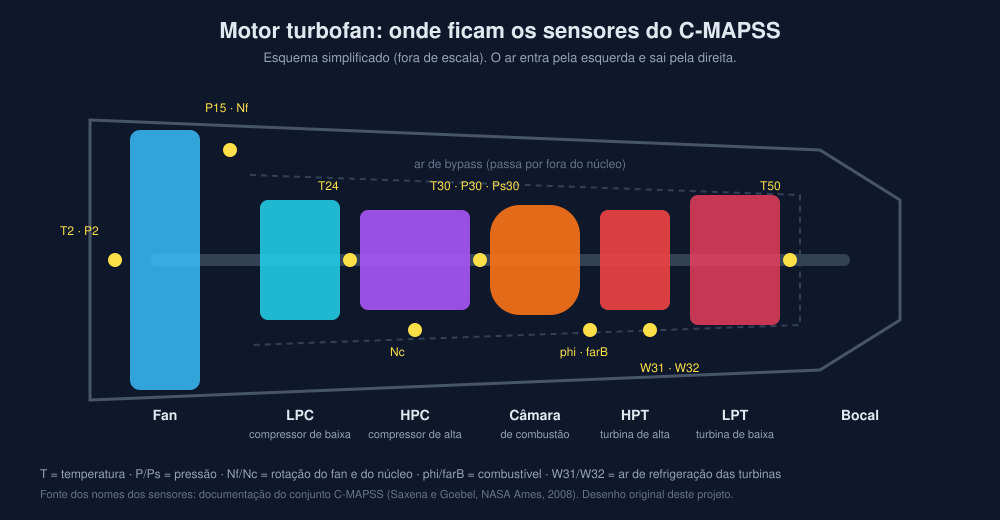
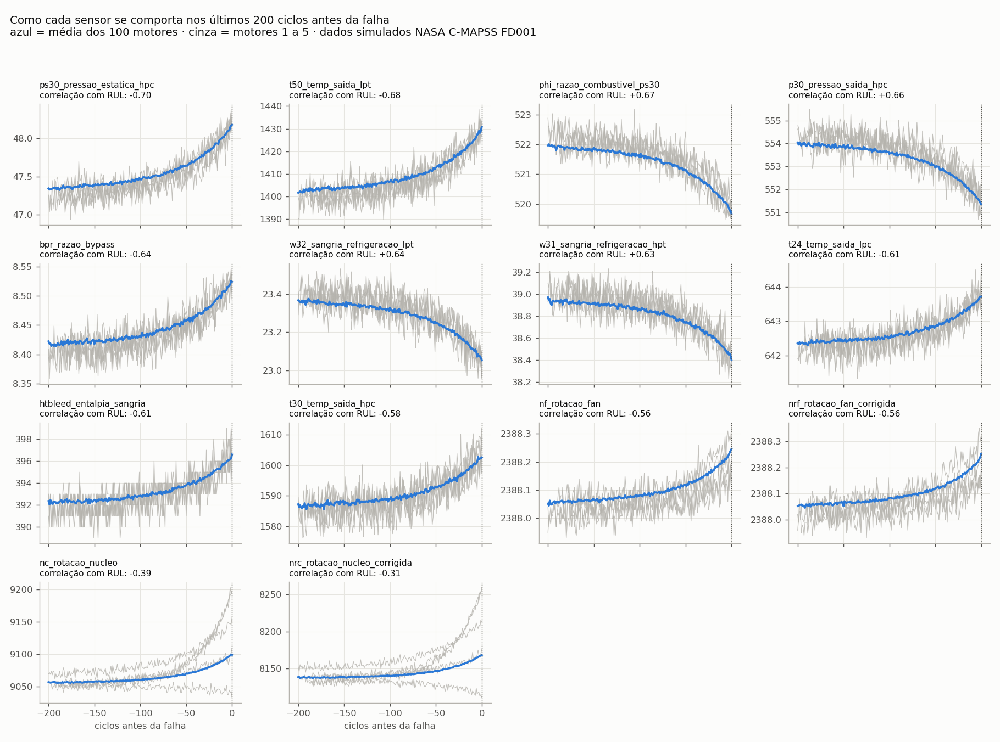
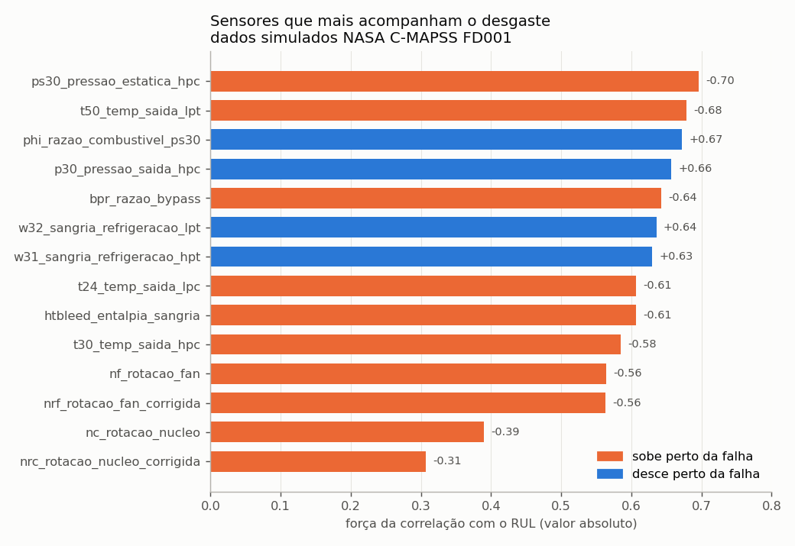
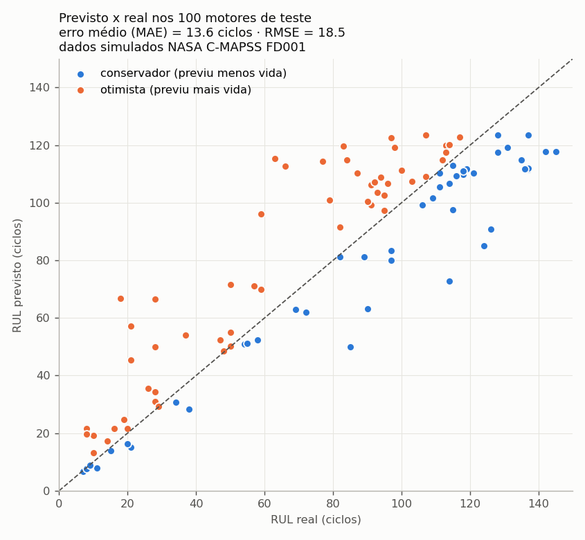
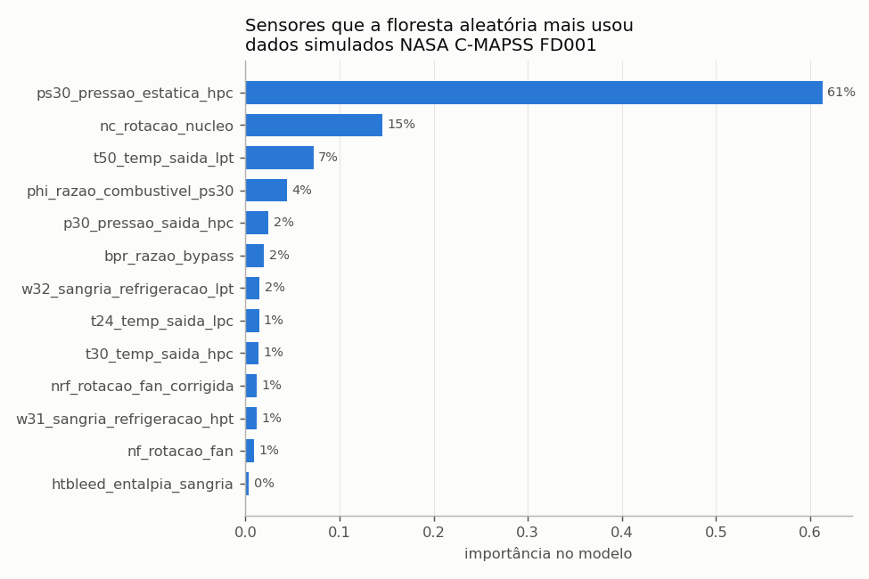

# Monitor de Saúde de Motores Turbofan

Manutenção preditiva de motores de avião com **Python, SQL e IA generativa**.

O projeto usa o conjunto público **C-MAPSS** da NASA: leituras de 21 sensores de
100 motores turbofan **simulados**, ciclo a ciclo, desde o motor novo até a falha.
O objetivo é prever a **vida útil restante (RUL)** de cada motor, ou seja, quantos
ciclos de voo ele ainda aguenta antes de precisar de manutenção, e mostrar isso de
um jeito útil para quem planeja a manutenção.



> Os dados são simulados e públicos (NASA). Não são dados reais de nenhuma
> companhia aérea ou fabricante.

## Plano

| Etapa | O que faz | Tecnologia | Status |
|---|---|---|---|
| 1 | Carregar os dados dos sensores num banco | Python, SQLite | ✅ |
| 2 | Análise exploratória: quais sensores mudam quando o motor degrada | pandas, matplotlib | ✅ |
| 3 | Modelo que prevê quantos ciclos faltam para a falha | scikit-learn | ✅ |
| 4 | Painel com os motores em risco | Streamlit | ✅ |
| 5 | Assistente de IA que responde em português consultando o banco | API da Anthropic | ⏳ |

## Como rodar

Um comando só (cria o ambiente na primeira vez e abre o painel no navegador):

```bash
./rodar.sh
```

O painel abre em http://localhost:8501. Se o banco e o modelo ainda não existirem, ele roda
as etapas 1 a 3 sozinho na primeira vez (cerca de 30 segundos).

Para rodar cada etapa separadamente:

```bash
.venv/bin/python src/01_carregar_banco.py        # cria dados/motores.db
.venv/bin/python src/02_analise_exploratoria.py  # gera as figuras da análise
.venv/bin/python src/03_modelo_rul.py            # treina o modelo e salva as previsões
.venv/bin/streamlit run src/04_painel.py         # abre o painel
```

## Versão web (sem servidor)

A pasta `web/` tem o mesmo painel rodando **dentro do navegador** com o
[stlite](https://github.com/whitphx/stlite) (Streamlit compilado para WebAssembly via Pyodide).
Não há servidor Python: o site só entrega arquivos estáticos, então dá para hospedar no
GitHub Pages ou em qualquer hospedagem de site. A primeira visita leva de 15 a 30 segundos,
enquanto o navegador baixa o Python.

```bash
.venv/bin/python src/exportar_web.py                    # atualiza web/ (painel + banco reduzido de 1,2 MB)
.venv/bin/python -m http.server 8000 --directory web    # teste local em http://localhost:8000
```

Publicação: o workflow `.github/workflows/pages.yml` publica `web/` no GitHub Pages a cada push
(ativar em Settings → Pages → Source: GitHub Actions). Outra opção é copiar o conteúdo de
`web/` para uma pasta de qualquer site estático.

## Resultados da análise exploratória (etapa 2)

- **7 dos 21 sensores são constantes** no FD001 (registram 1 ou 2 valores em 20 mil leituras)
  e foram descartados. Sobram **14 sensores úteis**, salvos em `dados/sensores_uteis.txt`.
- Os sensores mais ligados ao desgaste são a **pressão estática na saída do HPC (ps30)** e a
  **temperatura na saída da LPT (t50)**: os dois sobem perto da falha (correlação com o RUL
  de −0,70 e −0,68).
- A degradação **não é linear**: os sensores ficam quase estáveis no início da vida e só
  aceleram nos últimos ~100 ciclos. Isso vai guiar o modelo da etapa 3.
- A rotação do núcleo e a rotação do núcleo corrigida são quase a mesma informação
  (correlação de 0,96 entre si).




## Resultados do modelo (etapa 3)

- O alvo é o RUL **limitado a 125 ciclos**: antes disso os sensores ainda não mostram desgaste
  (visto na etapa 2), então o modelo trata qualquer motor com mais vida como "saudável".
- A validação separa **motores inteiros** (80 para treinar, 20 para validar), e não linhas
  soltas, para o modelo nunca ver um pedaço do mesmo motor que vai prever.

| Modelo | RMSE validação | MAE validação |
|---|---|---|
| Referência (sempre chuta a média) | 41,7 | 36,9 |
| Regressão linear | 20,5 | 16,5 |
| **Floresta aleatória** | **17,2** | **12,5** |

- No **teste oficial** (100 motores nunca vistos), a floresta aleatória erra em média
  **13,6 ciclos** (MAE) e tem RMSE de **18,5**.
- O sensor mais usado pelo modelo é a **pressão estática na saída do HPC (ps30)**, com 61% da
  importância, o mesmo que a etapa 2 já apontava.
- As previsões ficam em `previsoes_teste` no banco, para o painel e o assistente usarem.




## Painel (etapa 4)

O painel em Streamlit mostra a frota de teste dividida em **Crítico, Atenção e Saudável**,
com limites ajustáveis na barra lateral. Os limites padrão têm folga porque o modelo é
otimista em cerca de metade dos casos. O painel também traz os 20 motores com menos vida
prevista, a tabela completa e o detalhe de cada motor: o histórico dos sensores principais
comparado com a média de motores saudáveis e perto da falha.

## Dados

Subconjunto **FD001**: 100 motores no treino (vida de 128 a 362 ciclos, média de 206),
100 motores no teste, uma condição de operação e um modo de falha (degradação do HPC).

Referência: A. Saxena e K. Goebel (2008). *Turbofan Engine Degradation Simulation
Data Set*. NASA Ames Prognostics Data Repository.
